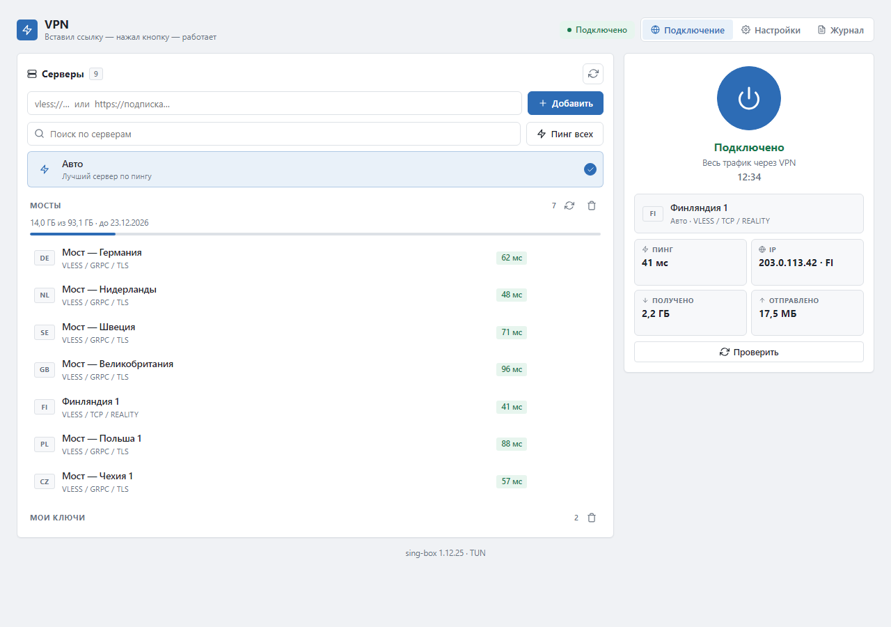

# VPN for OpenWrt

🇷🇺 [Русский](README.md) · 🇬🇧 English

**Paste a link, press the button, it works.** A simple VPN client for your router, available in LuCI under **Services → VPN**.
It runs [sing-box](https://github.com/SagerNet/sing-box) in TUN mode and routes your LAN through it.

[](https://github.com/timfdelfi/luci-vless-selective/actions/workflows/ci.yml)
[](https://github.com/timfdelfi/luci-vless-selective/releases)
[](LICENSE)
[](https://openwrt.org)
[](https://github.com/SagerNet/sing-box)



> The web interface is currently in Russian. The command line (`vless …`), logs and this documentation work regardless of language.
> Contributions of a translation are welcome (see [CONTRIBUTING.md](CONTRIBUTING.md), in Russian).

## Features

- **Zero setup.** Paste a subscription URL or a single key; everything else is configured automatically.
- **Auto server selection.** "Auto" mode measures latency and switches to the fastest server. Check interval, switch threshold and probe URL are configurable.
- **Formats.** `vless://`, `vmess://`, `trojan://`, `ss://`, `hysteria2://`, and subscriptions over `https://…` (plain, base64, Xray JSON). Reality, TLS, WebSocket, gRPC, HTTPUpgrade, h2.
- **Routing presets.** Everything, "everything except Russian sites", or "selected services only": Telegram, YouTube, Discord, Meta, X, AI services, 18+ — plus your own sites.
- **Subscription info.** Remaining traffic and expiry date, automatic subscription refresh.
- **Advanced.** Per-device selection, custom exclusions, Kill Switch, DNS through the VPN, IPv6 and QUIC blocking, MTU, TUN stack.
- **Ping.** "Ping all", per-server ping, and a direct (no-VPN) TCP-connect ping that works even while disconnected.
- **Your own VPN on phones and PCs keeps working.** Traffic from LAN devices to your subscription's servers bypasses the router's tunnel (setting "VPN servers bypass the tunnel").
- **Light and dark themes**, usable from a phone.
- **A tidy neighbour.** Its own sing-box instance; `/etc/sing-box` is never touched.

## Installation

**Windows**

1. Download `vless-vpn.zip` from [Releases](https://github.com/timfdelfi/luci-vless-selective/releases) and unpack it.
2. Verify the checksum against `vless-vpn.zip.sha256`: `certutil -hashfile vless-vpn.zip SHA256`.
3. Double-click `INSTALL.bat`, enter the router address (usually `192.168.1.1`) and the root password.
4. In the router UI open **Services → VPN** (hard refresh with Ctrl+F5).

**Linux / macOS / manual**

```
sha256sum -c vless-vpn.tar.gz.sha256
scp -O vless-vpn.tar.gz root@192.168.1.1:/tmp/
ssh root@192.168.1.1 "mkdir -p /tmp/vless-vpn && tar xzf /tmp/vless-vpn.tar.gz -C /tmp/vless-vpn && sh /tmp/vless-vpn/install.sh"
```

For OpenWrt 24.10 and older there is also an `.ipk`: `opkg install luci-vless-selective_*_all.ipk`.

The installer pulls in the dependencies (`sing-box`, `kmod-tun`, `curl`, `jq`, `ca-bundle`, `ip-full`, `nftables`). If copying is interrupted, it rolls back to the previous version.

**Uninstall:** `sh uninstall.sh`. Servers and subscriptions are kept for the next install; `sh uninstall.sh --purge` also deletes the key database.

Requirements: OpenWrt 24.10 or newer, sing-box 1.12 or newer.

## Usage

1. Paste a subscription URL (or a `vless://…` key) into the field and press **Add**.
2. Press the power button.
3. Done. "Auto" picks the best server; you can also pick one manually.

## What goes through the VPN

Choose a mode in **Settings → Routing**:

| Mode | Behaviour |
| --- | --- |
| All traffic | Everything goes through the VPN |
| Everything except Russian sites (default) | `.ru`, `.рф` and popular Russian services go direct |
| Selected services only | Only checked presets and your own sites go through the VPN; the rest goes direct |

Notes:

- "Selected services only" needs `dnsmasq-full` with `nftset` support. A service enters the VPN when its address is resolved through the router. `vless selftest` shows whether support is present; if not, the app falls back to the regular mode and logs why.
- Rules work by domain (SNI) and, for Telegram, by subnet. Traffic an app sends to a bare IP (for example Discord voice) may bypass the VPN; add the subnets to "Custom sites".
- "Custom exclusions" (always direct) take priority over presets.

## Discord via zapret (with a VPN fallback)

An optional separate bypass just for Discord: traffic goes directly through `nfqws` from [zapret](https://github.com/bol-van/zapret), without loading the VPN. If the bypass stops working, Discord switches to the VPN. The module tries strategies (from the Flowseal release first, then 8 built-in ones) until the Discord check passes, re-checks every 10 minutes and updates itself daily. Details (in Russian) are in [README.md](README.md#discord-через-zapret-с-запасным-путём-через-vpn). Commands: `vless-discord status | auto force | install | update | selftest | test | use <id>`.

Good to know: flow offloading is turned off while the bypass is on; voice cannot be checked automatically; a router that already runs its own zapret will not start this module.

## Troubleshooting

| Symptom | What to do |
| --- | --- |
| A link is not added | Run `/usr/bin/vless selftest` on the router: it reports what is missing |
| Subscription not downloading / "client not supported" | Subscriptions are fetched as the Happ Android app (`User-Agent: Happ/…` + router HWID). Change the User-Agent in Settings → DNS and network to a current Happ version |
| Connected but no internet | Stop Podkop and other VPNs, check the **Log** tab |
| "Selected services only" changes nothing | `dnsmasq-full` with `nftset` is required; check `logread -e vless` |
| A server is grey | It uses XHTTP, which sing-box does not support yet |
| No "VPN" menu entry | Ctrl+F5, then log in to LuCI again |

System log: `logread -e vless`. Still stuck? [Open an issue](https://github.com/timfdelfi/luci-vless-selective/issues/new/choose) and attach the `selftest` output. **Do not publish your links and keys.**

## Limitations

- The router takes one slot in your subscription's device limit (HWID is shown in Settings and in `vless selftest`).
- XHTTP (Xray transport) is not supported by sing-box.
- Do not run it together with Podkop or another VPN that manages LAN routing.
- Only IPv4 goes through the tunnel; client IPv6 is blocked in all modes (can be disabled).

## How it works

sing-box brings up a TUN interface `vless0`; LAN traffic is steered into it with `ip rule` (table 100), local networks bypass it. In selected-services mode only traffic to addresses of the chosen services is marked by nftables and tunnelled; dnsmasq fills the address set by domain. DNS queries go to sing-box (`127.0.0.77`) and leave through the VPN over DNS-over-TLS.

The backend is a CLI (`/usr/bin/vless <command>`, every command prints JSON) split into modules under `root/usr/share/vless/lib/`; the LuCI page calls it through an rpcd plugin. See [docs/ARCHITECTURE.md](docs/ARCHITECTURE.md) (in Russian) for components, data layout and lifecycle.

## Development

Run the same checks as CI:

```
sh ci/check-lf.sh        # LF line endings
sh ci/check-jq.sh        # jq scripts compile and use no regular expressions
shellcheck -s sh -S warning -e SC3043,SC2034 $(git ls-files '*.sh') root/usr/bin/vless
sh tests/run.sh          # parsing, config build, sing-box check, backend, Discord, modules, mocks
sh build.sh              # dist/: .tar.gz, .zip, .ipk and .sha256
MINIFY=1 sh build.sh     # same, with a minified main.js
```

Tests need `jq`, `python3`, `md5sum` and Linux (`/proc`); `sing-box` is optional and additionally validates the generated config. Coding rules and how to add a command, module or preset are in [CONTRIBUTING.md](CONTRIBUTING.md) (Russian). Release history: [CHANGELOG.md](CHANGELOG.md).

## License

[MIT](LICENSE)
