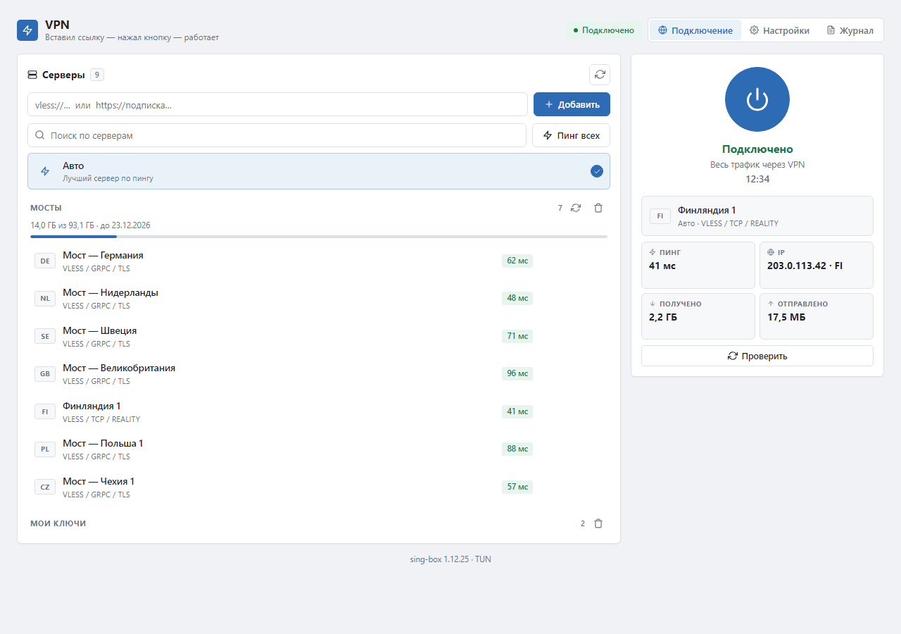
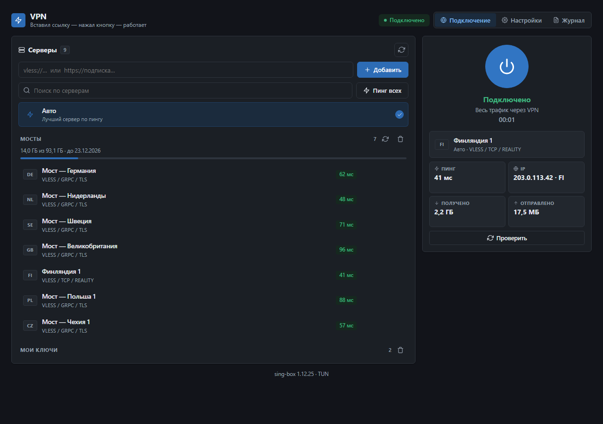
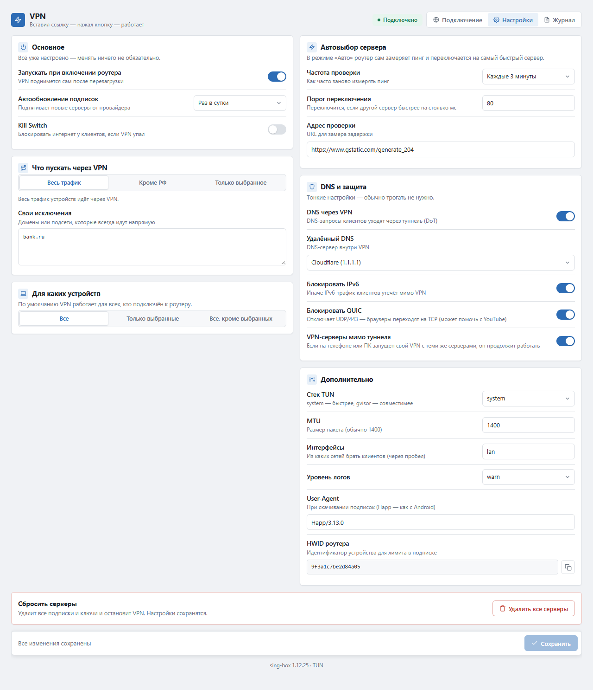
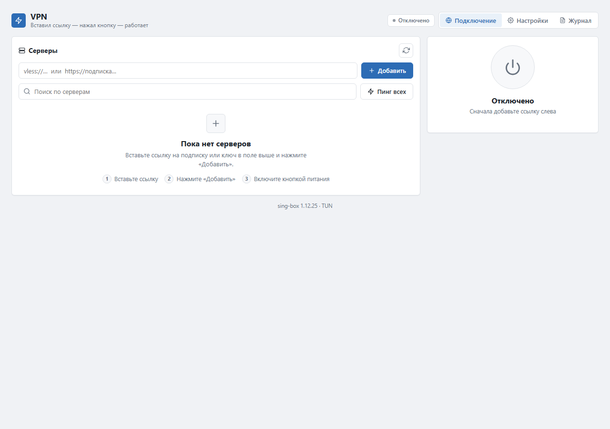
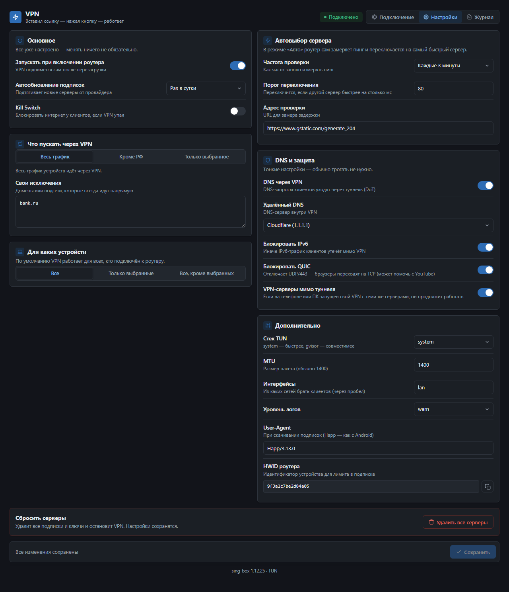
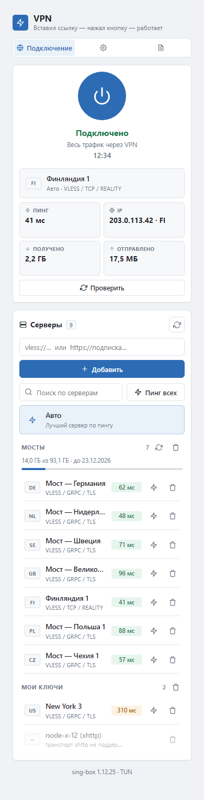

# VPN для OpenWrt

🇷🇺 Русский · 🇬🇧 [English](README.en.md)

**Вставил ссылку → нажал кнопку → работает.** Простой VPN-клиент для роутера. Пункт **Службы → VPN** в LuCI.

[](https://github.com/timfdelfi/luci-vless-selective/actions/workflows/ci.yml)
[](https://github.com/timfdelfi/luci-vless-selective/releases)
[](LICENSE)
[](https://openwrt.org)
[](https://github.com/SagerNet/sing-box)



## Возможности

- **Без настройки.** Вставьте ссылку на подписку или ключ — всё остальное настроится само.
- **Автовыбор сервера.** Режим «Авто» сам замеряет пинг и переключается на самый быстрый сервер.
  Частота проверки, порог переключения и адрес замера настраиваются.
- **Живой спидометр и счётчик трафика.** Скорость загрузки и отдачи (↓/↑) в реальном времени и объём переданных данных за текущую сессию прямо на карточке подключения.
- **Защита прямого DNS (DoT / DoH).** Поддержка шифрованного DNS для прямого трафика (`tls://77.88.8.8`, `https://dns.adguard-dns.com/dns-query` и др.) — защита незаблокированных сайтов от перехвата UDP:53 и DNS-poisoning провайдерами (ТСПУ).
- **Резервное копирование и экспорт.** Кнопки «Экспорт настроек» и «Импорт» в веб-интерфейсе (а также консольные команды `vless export` и `vless import`): лёгкий бэкап и восстановление серверов, исключений и параметров перед обновлением прошивки.
- **Автозагрузка официального sing-box.** Если в opkg нет пакета sing-box или установлена устаревшая сборка без TUN, установщик сам определит архитектуру роутера (`mipsle`, `aarch64`, `arm`, `x86_64`) и скачает официальный бинарник с GitHub Releases (`vless fetch-core`).
- **Форматы.** `vless://`, `vmess://`, `trojan://`, `ss://`, `hysteria2://`, подписки `https://…` (обычные, base64, Xray-JSON). Reality, TLS, WebSocket, gRPC, HTTPUpgrade, h2.
- **Пресеты маршрутизации.** Весь трафик, «всё, кроме российских сайтов» или «только выбранное»: Telegram, YouTube, Discord, Meta, X, ИИ-сервисы, 18+ — плюс свои сайты.
- **Информация о подписке.** Остаток трафика и срок действия, автообновление подписок.
- **Для продвинутых.** Выбор устройств, свои исключения, Kill Switch, DNS через VPN, блокировка IPv6 и QUIC, MTU, режим TUN.
- **Пинг.** Кнопка «Пинг всех» над списком, значок молнии у каждого сервера и «Пинг выбранного сервера» на карточке подключения. Пинг работает даже без VPN — измеряется напрямую через TCP connect.
- **Свой VPN на телефоне и ПК.** Трафик устройств к серверам вашей подписки идёт мимо туннеля роутера, поэтому VPN-клиент с теми же серверами на телефоне или компьютере продолжает работать (настройка «VPN-серверы мимо туннеля»).
- **Светлая и тёмная тема** — подстраивается под тему роутера, работает и с телефона.
- **Аккуратный сосед.** Свой отдельный экземпляр sing-box, `/etc/sing-box` не трогает.

## Скриншоты

| Подключено | Тёмная тема |
| --- | --- |
|  |  |
| **Настройки** | **Первый запуск** |
|  |  |

**Тёмные настройки и мобильная версия**

 

## Установка

**Установка в одну строчку через SSH (рекомендуется)**

Подключитесь к роутеру по SSH и вставьте команду в терминал:

```sh
sh -c "$(curl -fsSL https://github.com/timfdelfi/luci-vless-selective/releases/latest/download/install.sh)"
```

Скрипт сам скачает свежий релиз, определит архитектуру роутера (`mipsle`, `aarch64`, `arm`, `x86_64` и др.), установит нужные пакеты и официальный бинарник `sing-box` (даже если его нет в репозитории OpenWrt).

**Windows**

1. Скачайте `vless-vpn.zip` из [Releases](https://github.com/timfdelfi/luci-vless-selective/releases) и распакуйте.
2. Сверьте контрольную сумму файлом `vless-vpn.zip.sha256` (рядом лежит `SHA256SUMS`):

   ```
   certutil -hashfile vless-vpn.zip SHA256
   ```

3. Дважды щёлкните `INSTALL.bat`, введите адрес роутера (обычно `192.168.1.1`) и пароль root.
4. В веб-интерфейсе роутера: **Службы → VPN** (обновите страницу через Ctrl+F5).

Скрипт сам доустановит зависимости (`kmod-tun`, `curl`, `jq`, `ca-bundle`, `ip-full`, `nftables`) и `sing-box`.
Если копирование оборвалось, установщик это заметит и откатит файлы, а не оставит
полуустановленное приложение.

**Linux / macOS / вручную**

```
sha256sum -c vless-vpn.tar.gz.sha256
scp -O vless-vpn.tar.gz root@192.168.1.1:/tmp/
ssh root@192.168.1.1 "mkdir -p /tmp/vless-vpn && tar xzf /tmp/vless-vpn.tar.gz -C /tmp/vless-vpn && sh /tmp/vless-vpn/install.sh"
```

Для OpenWrt 24.10 и старше доступен и `.ipk`: `opkg install luci-vless-selective_*_all.ipk`.

**Удаление:** `sh uninstall.sh`. Серверы и подписки при этом сохраняются — после
переустановки не придётся вводить всё заново. Полностью стереть базу с ключами и
токенами подписок: `sh uninstall.sh --purge`.

## Как пользоваться

1. Вставьте ссылку на подписку (или ключ `vless://…`) в поле и нажмите **Добавить**.
2. Нажмите кнопку питания справа.
3. Готово. «Авто» выбирает лучший сервер сам; при желании выберите сервер вручную.

## Что пускать через VPN

В **Настройки → Маршрутизация** выберите режим:

| Режим | Что происходит |
| --- | --- |
| Весь трафик | Всё идёт через VPN |
| Всё, кроме российских сайтов (по умолчанию) | `.ru`, `.рф` и популярные российские сервисы идут напрямую |
| Только выбранные сервисы | Через VPN идут только отмеченные пресеты и ваши сайты, остальное — напрямую |

Пресеты: Telegram (домены и подсети), YouTube, Discord, Meta (Instagram, Facebook, WhatsApp, Threads), X (Twitter),
ИИ-сервисы (ChatGPT, Claude, Gemini, Perplexity, Grok), 18+. Свои сайты и подсети добавляются в поле ниже;
«Свои исключения» (всегда напрямую) имеют приоритет над пресетами.

Заметки:

- В режиме «только выбранное» остальной трафик не заворачивается в туннель и идёт напрямую. Для этого нужен `dnsmasq-full` с поддержкой nftset (обычно стоит в OpenWrt по умолчанию). Сервис попадает в VPN, когда его адрес запрошен через роутер; `vless selftest` покажет, есть ли поддержка.
- Правила работают по доменам (по SNI) и, для Telegram, по подсетям. Трафик, который приложение отправляет на «голый» IP
  (например, голосовые каналы Discord), может пойти мимо VPN — добавьте нужные подсети в «Свои сайты».
- Списки доменов и подсетей лежат в `root/usr/share/vless/presets.jq` — их легко дополнить.
  Чтобы добавить пресет, ключ нужно прописать в трёх местах, и они должны совпадать:
  1. `root/usr/share/vless/presets.jq` — домены и подсети (`presets`);
  2. `root/usr/bin/vless` — переменная `PRESET_KEYS`;
  3. `htdocs/luci-static/resources/view/vless/main.js` — массив `PRESETS` (название в интерфейсе).
  Затем `sh tests/run.sh` и `sh build.sh`.

## Если что-то не работает

| Симптом | Что сделать |
| --- | --- |
| Не добавляется ссылка | На роутере выполните `/usr/bin/vless selftest` — покажет, чего не хватает |
| Подписка не скачивается или «Ваш клиент не поддерживается» | Подписки скачиваются как Happ на Android (`User-Agent: Happ/3.13.0` + HWID роутера). Если панель всё равно ругается, поменяйте User-Agent в «Настройки → DNS и сеть» на актуальную версию Happ |
| Подключилось, но интернета нет | Остановите Podkop и другие VPN, смотрите вкладку **Журнал** |
| В режиме «Только выбранные сервисы» VPN ничего не меняет | Нужен `dnsmasq-full` с поддержкой `nftset`. Проверьте `logread -e vless`: если там «не найден каталог конфигурации dnsmasq» или «dnsmasq собран без nftset» — выборочный режим не сможет работать, приложение переключится на обычный |
| Сервер серый в списке | Он использует XHTTP, который sing-box пока не поддерживает |
| Пункта «VPN» нет в меню | Ctrl+F5, затем перелогиньтесь в LuCI |

Причины, о которых пишет само приложение, видны в системном журнале:

```
logread -e vless
```

Там же появляются сообщения о неудачных `ip rule`, об утечке IPv6 и о сбое
автообновления подписок.

Не помогло — [создайте issue](https://github.com/timfdelfi/luci-vless-selective/issues/new/choose) и приложите вывод `selftest`. **Не публикуйте свои ссылки и ключи.**

## Как это работает

sing-box поднимает TUN-интерфейс `vless0`; трафик устройств из LAN направляется в него через `ip rule` (таблица 100), локальные сети идут мимо. В режиме «Только выбранные сервисы» в туннель попадает только трафик к адресам выбранных сервисов: nftables помечает его, а набор адресов заполняет dnsmasq по доменам. DNS-запросы клиентов dnsmasq отправляет в sing-box
(127.0.0.77), и они уходят через VPN по DNS-over-TLS.

| Файл | Назначение |
| --- | --- |
| `htdocs/…/view/vless/main.js` | интерфейс (LuCI JS-view) |
| `root/usr/bin/vless` | бэкенд: диспетчер команд (`vless <команда>`, всё отвечает JSON) |
| `root/usr/share/vless/lib/*.sh` | модули бэкенда: подписки, настройки, запуск, сеть, выборочная маршрутизация, диагностика |
| `root/usr/share/vless/parse.jq` | разбор ссылок и подписок (без регулярок — работает на любом jq) |
| `root/usr/share/vless/build.jq` | сборка конфига sing-box |
| `root/usr/share/vless/presets.jq` | пресеты выборочной маршрутизации (домены и подсети) |
| `root/etc/init.d/vless` | запуск через procd |
| `root/usr/bin/vless-discord` | обход Discord: nfqws, перебор стратегий, запасной путь через VPN |
| `root/usr/share/vless/discord-strategies.conf` | стратегии обхода Discord |
| `root/etc/init.d/vless-discord` | запуск nfqws через procd |
| `root/usr/libexec/rpcd/vless` | мост интерфейс ↔ бэкенд |

Подробнее о компонентах, модулях бэкенда, хранении данных и порядке подключения — в [docs/ARCHITECTURE.md](docs/ARCHITECTURE.md).

## Discord через zapret (с запасным путём через VPN)

В «Настройки → Discord» можно включить отдельный обход только для Discord: трафик идёт напрямую через `nfqws` из [zapret](https://github.com/bol-van/zapret), не нагружая VPN, а голос и демонстрация экрана не получают лишней задержки. Если обход не сработал — Discord сам переключается на VPN.

Режимы: «не трогать», «zapret, при сбое — VPN» (рекомендуется), «только zapret», «только VPN».

Что делает модуль (`vless-discord`):

1. Ставит `kmod-nft-queue`, `kmod-nfnetlink-queue` и скачивает `nfqws` под архитектуру роутера из релиза zapret. Архив проверяется по контрольной сумме из GitHub API, бинарник — запуском.
2. Из релиза [Flowseal/zapret-discord-youtube](https://github.com/Flowseal/zapret-discord-youtube) берёт `.bin`-фейки, список доменов Discord и **сами стратегии**: разбирает все `general*.bat` (general, ALT, ALT2 … ALTn) и переводит их аргументы `winws` в `nfqws`, оставляя только то, что относится к Discord. Архив проверяется по sha256.
3. Заворачивает в `nfqws` только Discord: TCP 443/2053/2083/2087/2096/8443 по списку доменов и UDP 19294–19344, 50000–50100 (голос).
4. Перебирает стратегии (сначала из релиза Flowseal, потом 8 встроенных запасных), пока проверка (API, gateway, CDN Discord) не пройдёт, и запоминает рабочую. Проверка идёт каждые 10 минут; один сбой маршрут не меняет, два подряд — запускают новый перебор.
5. **Автообновление:** раз в сутки (04:23) проверяет новые версии `nfqws` и релиза Flowseal; после обновления перезапускает `nfqws` и проверяет Discord, а если не открывается — подбирает стратегию заново.
6. Если не подошла ни одна — в режиме «zapret, при сбое — VPN» Discord уходит в VPN (если VPN был выключен, он запускается только ради Discord и гасится, когда zapret снова работает). Раз в 6 часов модуль пробует вернуться на zapret.

Что важно знать:

- **Flow offloading отключается** (zapret с ним не работает). Прежнее значение возвращается при выключении обхода. Можно запретить это в настройках — тогда обход, скорее всего, не заработает.
- **Голос проверить автоматически нельзя**: проверка покрывает вход в Discord, API, чат и CDN. Если чат работает, а голос нет, смотрите `vless-discord selftest` и пробуйте другую стратегию вручную.
- Стратегии подбираются под провайдера, а не под Discord вообще: у кого-то подойдёт первая, у кого-то ни одна.
- В режиме «всё через VPN» UDP на портах 19294–19344 и 50000–50100 идёт мимо туннеля, пока Discord работает через zapret.
- Если на роутере уже стоит свой zapret, модуль не запускается (два `nfqws` на один трафик мешают друг другу).

Команды: `vless-discord status | auto force | install | update | selftest | test | use <id>`.

`update` запускает обновление вручную. `test` показывает, отвечает ли каждый адрес Discord и доходят ли пакеты до nfqws; `use s3` закрепляет стратегию вручную.

## Ограничения

- Роутер занимает один слот в лимите устройств вашей подписки (HWID виден в «Настройки → DNS и сеть» и в `vless selftest`).
- XHTTP (транспорт Xray) sing-box не поддерживает.
- Не запускайте одновременно с Podkop или другим VPN, который управляет маршрутизацией LAN.
- Внутри туннеля только IPv4; IPv6 клиентов блокируется во всех режимах (можно отключить).
- Нужен sing-box 1.12 или новее.

## Разработка

Для тестов нужны `jq`, `python3` (тестовая подписка), `md5sum` и Linux (`/proc`). `sing-box` дополнительно проверяет сгенерированный конфиг, если установлен. Для сборки нужны `jq`, `tar`, `zip` (для Windows-архива) и `ar` из binutils.

Правила кода, как добавить команду, модуль или пресет и что проверять перед PR — в [CONTRIBUTING.md](CONTRIBUTING.md).

Локально всё то же, что гоняет CI:

```
sh ci/check-lf.sh   # переводы строк LF
sh ci/check-jq.sh   # jq компилируется и не использует регулярные выражения
shellcheck -s sh -S warning -e SC3043,SC2034 $(git ls-files '*.sh') root/usr/bin/vless
sh tests/run.sh     # разбор ссылок, сборка конфига, sing-box check, бэкенд, Discord, модули, заглушки
sh tests/modules.sh # только состав и связность модулей (jq не нужен)
sh tests/mock-drift.sh   # заглушки curl и uci не разошлись с кодом (jq не нужен)
sh ci/minify-js.sh  # бюджет размера main.js и пробная минификация (нужны node и сеть)
sh build.sh         # dist/: vless-vpn.tar.gz, .zip, .ipk и .sha256
MINIFY=1 sh build.sh   # то же, но с минифицированным main.js
```

Тесты интерфейса гоняются в headless Chromium и заодно перерисовывают скриншоты
в `tests/ui/out/`:

```
npm install playwright && npx playwright install chromium
node tests/ui/shot.js                 # проверки + скриншоты в tests/ui/out/
node tests/ui/shot.js docs/screenshots   # сразу готовые картинки для README
```

Если браузер установлен не туда, куда его ищет Playwright, укажите путь сам:
`PW_CHROMIUM=/path/to/chromium node tests/ui/shot.js`.

Скриншоты в `docs/screenshots/` берутся именно отсюда, поэтому после изменения
внешнего вида достаточно перегенерировать их одной командой.

**Релиз.** Версия пакета задаётся в `VERSION`. Перед выпуском обновите её, затем:

```
git tag v<версия> && git push --tags
```

Тег с буквой `v` запускает сборку: CI прогоняет проверки, собирает `vless-vpn.zip`
(Windows), `vless-vpn.tar.gz`, `.ipk` и файлы `.sha256`, после чего прикрепляет всё
к релизу на GitHub. Тег не совпадёт с `VERSION` — сборка упадёт с понятной ошибкой;
тег без буквы `v` (как случилось с `1.3.2`) релиз не создаст вовсе.

**Обязательные проверки в CI.** Линтер `shellcheck` и синтаксис всех скриптов,
переводы строк LF, компилируемость jq-скриптов и запрет регулярных выражений в них
(на роутерах jq часто без Oniguruma), соответствие методов в `rpcd list` и ACL,
`sing-box check` для сгенерированного конфига и права `0755` на скрипты внутри `.ipk`.

Файлы в репозитории должны быть с переводами строк LF (иначе `#!/bin/sh` на роутере не запустится) — это
гарантирует `.gitattributes`; CI проверяет, что CRLF нигде нет (кроме `INSTALL.bat`).

## История изменений

См. [CHANGELOG.md](CHANGELOG.md).

## Лицензия

[MIT](LICENSE)