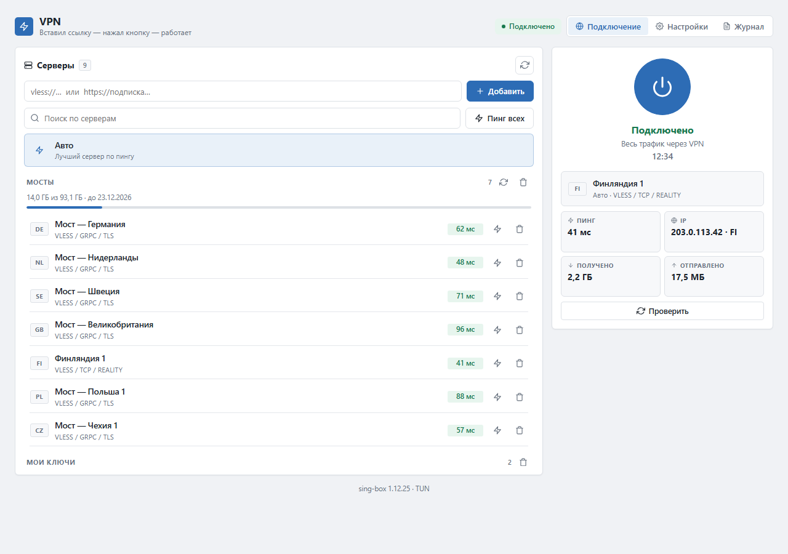
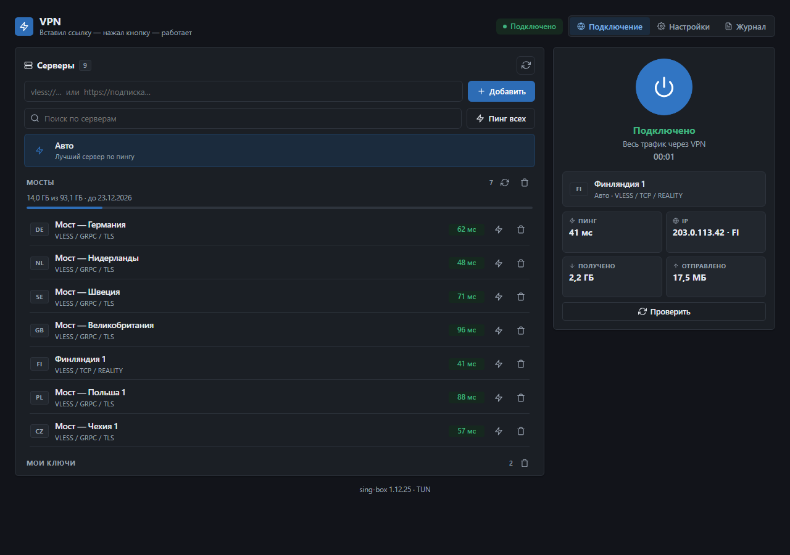
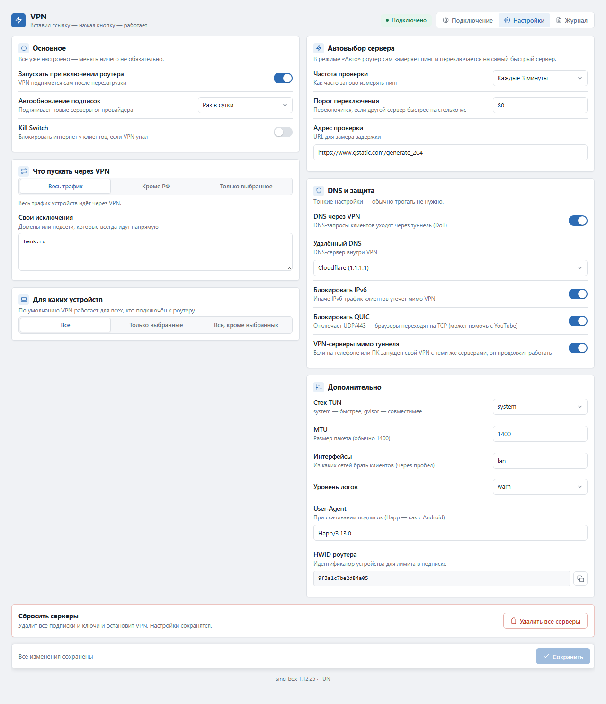
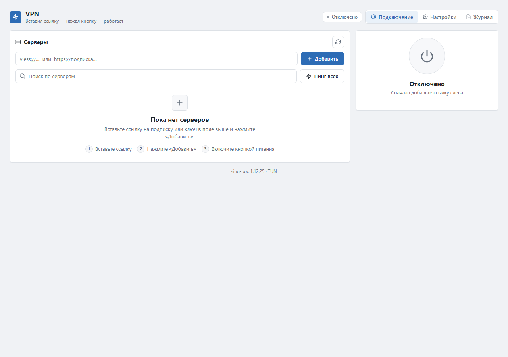
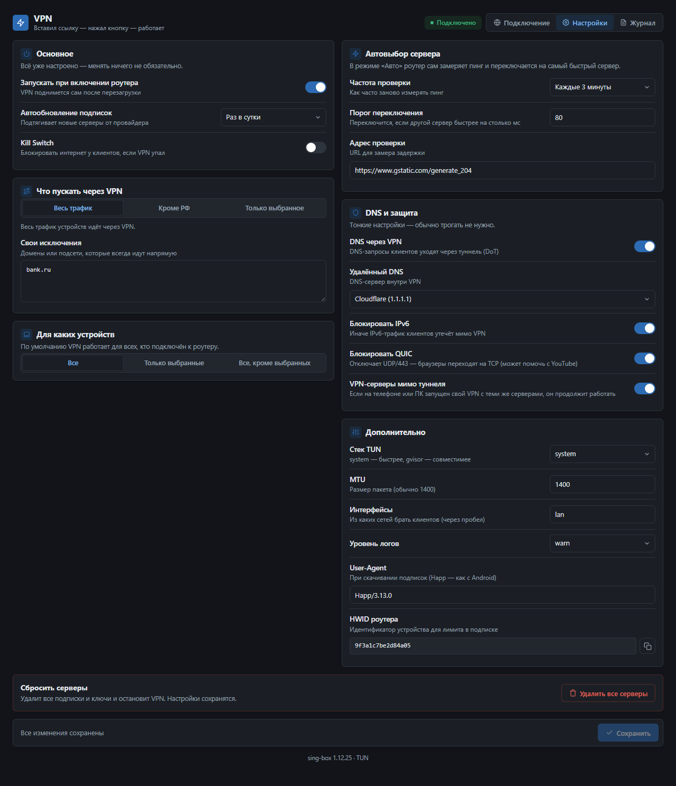
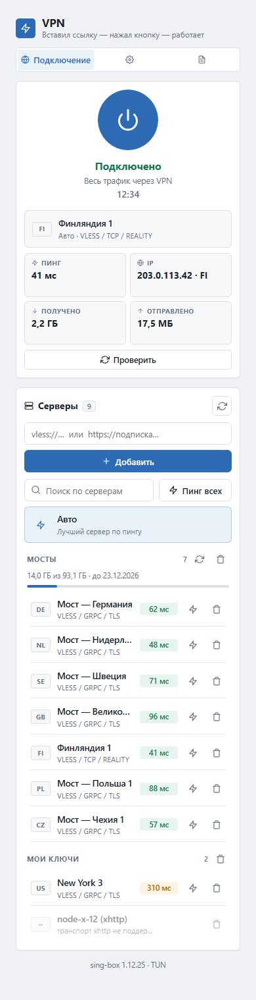

# VPN для OpenWrt

**Вставил ссылку → нажал кнопку → работает.** Простой VPN-клиент для роутера. Пункт **Службы → VPN** в LuCI.

[](https://github.com/timfdelfi/luci-vless-selective/actions/workflows/ci.yml)
[](https://github.com/timfdelfi/luci-vless-selective/releases)
[](LICENSE)
[](https://openwrt.org)
[](https://github.com/SagerNet/sing-box)



## Возможности

- **Без настройки.** Вставьте ссылку на подписку или ключ — всё остальное настроится само.
- **Автовыбор сервера.** Режим «Авто» сам замеряет пинг и переключается на самый быстрый сервер.
  Частота проверки, порог переключения и адрес замера настраиваются.
- **Форматы.** `vless://`, `vmess://`, `trojan://`, `ss://`, `hysteria2://`, подписки `https://…` (обычные, base64, Xray-JSON). Reality, TLS, WebSocket, gRPC, HTTPUpgrade, h2.
- **Пресеты маршрутизации.** Весь трафик, «всё, кроме российских сайтов» или «только выбранное»: Telegram, YouTube, Discord, Meta, X, ИИ-сервисы, 18+ — плюс свои сайты.
- **Информация о подписке.** Остаток трафика и срок действия, автообновление подписок.
- **Для продвинутых.** Выбор устройств, свои исключения, Kill Switch, DNS через VPN, блокировка IPv6 и QUIC, MTU, режим TUN.
- **Пинг.** Кнопка «Пинг всех» над списком, значок молнии у каждого сервера и «Пинг выбранного сервера» на карточке подключения. Пинг работает даже без VPN — измеряется напрямую через TCP connect.
- **Свой VPN на телефоне и ПК.** Трафик устройств к серверам вашей подписки идёт мимо туннеля роутера, поэтому VPN-клиент с теми же серверами на телефоне или компьютере продолжает работать (настройка «VPN-серверы мимо туннеля»).
- **Светлая и тёмная тема** — подстраивается под тему роутера, работает и с телефона.
- **Аккуратный сосед.** Свой отдельный экземпляр sing-box, `/etc/sing-box` не трогает.

## Скриншоты

| Подключено | Тёмная тема |
| --- | --- |
|  |  |
| **Настройки** | **Первый запуск** |
|  |  |

**Тёмные настройки и мобильная версия**

 

## Установка

**Windows**

1. Скачайте `vless-vpn.zip` из [Releases](https://github.com/timfdelfi/luci-vless-selective/releases) и распакуйте.
2. Сверьте контрольную сумму файлом `vless-vpn.zip.sha256` (рядом лежит `SHA256SUMS`):

   ```
   certutil -hashfile vless-vpn.zip SHA256
   ```

3. Дважды щёлкните `INSTALL.bat`, введите адрес роутера (обычно `192.168.1.1`) и пароль root.
4. В веб-интерфейсе роутера: **Службы → VPN** (обновите страницу через Ctrl+F5).

Скрипт сам доустановит `sing-box`, `kmod-tun`, `curl`, `jq`, `ca-bundle`, `ip-full`, `nftables`.
Если копирование оборвалось, установщик это заметит и откатит файлы, а не оставит
полуустановленное приложение.

**Linux / macOS / вручную**

```
sha256sum -c vless-vpn.tar.gz.sha256
scp -O vless-vpn.tar.gz root@192.168.1.1:/tmp/
ssh root@192.168.1.1 "mkdir -p /tmp/vless-vpn && tar xzf /tmp/vless-vpn.tar.gz -C /tmp/vless-vpn && sh /tmp/vless-vpn/install.sh"
```

Для OpenWrt 24.10 и старше доступен и `.ipk`: `opkg install luci-vless-selective_*_all.ipk`.

**Удаление:** `sh uninstall.sh`. Серверы и подписки при этом сохраняются — после
переустановки не придётся вводить всё заново. Полностью стереть базу с ключами и
токенами подписок: `sh uninstall.sh --purge`.

## Как пользоваться

1. Вставьте ссылку на подписку (или ключ `vless://…`) в поле и нажмите **Добавить**.
2. Нажмите кнопку питания справа.
3. Готово. «Авто» выбирает лучший сервер сам; при желании выберите сервер вручную.

## Что пускать через VPN

В **Настройки → Маршрутизация** выберите режим:

| Режим | Что происходит |
| --- | --- |
| Весь трафик | Всё идёт через VPN |
| Всё, кроме российских сайтов (по умолчанию) | `.ru`, `.рф` и популярные российские сервисы идут напрямую |
| Только выбранные сервисы | Через VPN идут только отмеченные пресеты и ваши сайты, остальное — напрямую |

Пресеты: Telegram (домены и подсети), YouTube, Discord, Meta (Instagram, Facebook, WhatsApp, Threads), X (Twitter),
ИИ-сервисы (ChatGPT, Claude, Gemini, Perplexity, Grok), 18+. Свои сайты и подсети добавляются в поле ниже;
«Свои исключения» (всегда напрямую) имеют приоритет над пресетами.

Заметки:

- В режиме «только выбранное» остальной трафик не заворачивается в туннель и идёт напрямую. Для этого нужен `dnsmasq-full` с поддержкой nftset (обычно стоит в OpenWrt по умолчанию). Сервис попадает в VPN, когда его адрес запрошен через роутер; `vless selftest` покажет, есть ли поддержка.
- Правила работают по доменам (по SNI) и, для Telegram, по подсетям. Трафик, который приложение отправляет на «голый» IP
  (например, голосовые каналы Discord), может пойти мимо VPN — добавьте нужные подсети в «Свои сайты».
- Списки доменов и подсетей лежат в `root/usr/share/vless/presets.jq` — их легко дополнить.
  Чтобы добавить пресет, ключ нужно прописать в трёх местах, и они должны совпадать:
  1. `root/usr/share/vless/presets.jq` — домены и подсети (`presets`);
  2. `root/usr/bin/vless` — переменная `PRESET_KEYS`;
  3. `htdocs/luci-static/resources/view/vless/main.js` — массив `PRESETS` (название в интерфейсе).
  Затем `sh tests/run.sh` и `sh build.sh`.

## Если что-то не работает

| Симптом | Что сделать |
| --- | --- |
| Не добавляется ссылка | На роутере выполните `/usr/bin/vless selftest` — покажет, чего не хватает |
| Подписка не скачивается или «Ваш клиент не поддерживается» | Подписки скачиваются как Happ на Android (`User-Agent: Happ/3.13.0` + HWID роутера). Если панель всё равно ругается, поменяйте User-Agent в «Настройки → DNS и сеть» на актуальную версию Happ |
| Подключилось, но интернета нет | Остановите Podkop и другие VPN, смотрите вкладку **Журнал** |
| В режиме «Только выбранные сервисы» VPN ничего не меняет | Нужен `dnsmasq-full` с поддержкой `nftset`. Проверьте `logread -e vless`: если там «не найден каталог конфигурации dnsmasq» или «dnsmasq собран без nftset» — выборочный режим не сможет работать, приложение переключится на обычный |
| Сервер серый в списке | Он использует XHTTP, который sing-box пока не поддерживает |
| Пункта «VPN» нет в меню | Ctrl+F5, затем перелогиньтесь в LuCI |

Причины, о которых пишет само приложение, видны в системном журнале:

```
logread -e vless
```

Там же появляются сообщения о неудачных `ip rule`, об утечке IPv6 и о сбое
автообновления подписок.

Не помогло — [создайте issue](https://github.com/timfdelfi/luci-vless-selective/issues/new/choose) и приложите вывод `selftest`. **Не публикуйте свои ссылки и ключи.**

## Как это работает

sing-box поднимает TUN-интерфейс `vless0`; трафик устройств из LAN направляется в него через `ip rule` (таблица 100), локальные сети идут мимо. В режиме «Только выбранные сервисы» в туннель попадает только трафик к адресам выбранных сервисов: nftables помечает его, а набор адресов заполняет dnsmasq по доменам. DNS-запросы клиентов dnsmasq отправляет в sing-box
(127.0.0.77), и они уходят через VPN по DNS-over-TLS.

| Файл | Назначение |
| --- | --- |
| `htdocs/…/view/vless/main.js` | интерфейс (LuCI JS-view) |
| `root/usr/bin/vless` | бэкенд: подписки, конфиг, маршрутизация, DNS |
| `root/usr/share/vless/parse.jq` | разбор ссылок и подписок (без регулярок — работает на любом jq) |
| `root/usr/share/vless/build.jq` | сборка конфига sing-box |
| `root/usr/share/vless/presets.jq` | пресеты выборочной маршрутизации (домены и подсети) |
| `root/etc/init.d/vless` | запуск через procd |
| `root/usr/libexec/rpcd/vless` | мост интерфейс ↔ бэкенд |

## Ограничения

- Роутер занимает один слот в лимите устройств вашей подписки (HWID виден в «Настройки → DNS и сеть» и в `vless selftest`).
- XHTTP (транспорт Xray) sing-box не поддерживает.
- Не запускайте одновременно с Podkop или другим VPN, который управляет маршрутизацией LAN.
- Внутри туннеля только IPv4; IPv6 клиентов блокируется во всех режимах (можно отключить).
- Нужен sing-box 1.12 или новее.

## Разработка

Для тестов нужны `jq`, `python3` (тестовая подписка), `md5sum` и Linux (`/proc`). `sing-box` дополнительно проверяет сгенерированный конфиг, если установлен. Для сборки нужны `jq`, `tar`, `zip` (для Windows-архива) и `ar` из binutils.

Локально всё то же, что гоняет CI:

```
sh ci/check-lf.sh   # переводы строк LF
sh ci/check-jq.sh   # jq компилируется и не использует регулярные выражения
shellcheck -s sh -S warning -e SC3043,SC2034 root/usr/bin/vless install.sh uninstall.sh
sh tests/run.sh     # разбор ссылок, сборка конфига, sing-box check
sh build.sh         # dist/: vless-vpn.tar.gz, .zip, .ipk и .sha256
```

Тесты интерфейса гоняются в headless Chromium и заодно перерисовывают скриншоты
в `tests/ui/out/`:

```
npm install playwright && npx playwright install chromium
node tests/ui/shot.js                 # проверки + скриншоты в tests/ui/out/
node tests/ui/shot.js docs/screenshots   # сразу готовые картинки для README
```

Если браузер установлен не туда, куда его ищет Playwright, укажите путь сам:
`PW_CHROMIUM=/path/to/chromium node tests/ui/shot.js`.

Скриншоты в `docs/screenshots/` берутся именно отсюда, поэтому после изменения
внешнего вида достаточно перегенерировать их одной командой.

**Релиз.** Версия пакета задаётся в `VERSION`. Перед выпуском обновите её, затем:

```
git tag v<версия> && git push --tags
```

Тег с буквой `v` запускает сборку: CI прогоняет проверки, собирает `vless-vpn.zip`
(Windows), `vless-vpn.tar.gz`, `.ipk` и файлы `.sha256`, после чего прикрепляет всё
к релизу на GitHub. Тег не совпадёт с `VERSION` — сборка упадёт с понятной ошибкой;
тег без буквы `v` (как случилось с `1.3.2`) релиз не создаст вовсе.

**Обязательные проверки в CI.** Линтер `shellcheck` и синтаксис всех скриптов,
переводы строк LF, компилируемость jq-скриптов и запрет регулярных выражений в них
(на роутерах jq часто без Oniguruma), соответствие методов в `rpcd list` и ACL,
`sing-box check` для сгенерированного конфига и права `0755` на скрипты внутри `.ipk`.

Файлы в репозитории должны быть с переводами строк LF (иначе `#!/bin/sh` на роутере не запустится) — это
гарантирует `.gitattributes`; CI проверяет, что CRLF нигде нет (кроме `INSTALL.bat`).

## Что нового в 1.4.0

Исправления:

- **DNS и выборочная маршрутизация наконец настраивались.** Поиск каталога
  конфигурации dnsmasq искал `/tmp/dnsmasq.@dnsmasq[0].d` и `/tmp/dnsmasq.*.d`,
  но настоящее имя — просто `/tmp/dnsmasq.d`. Из-за этого `nftset=` не попадали
  в dnsmasq, набор адресов оставался пустым, и режим «Только выбранные сервисы»
  тихо пропускал весь трафик мимо туннеля — при зелёной надписи «Подключено».
  Там же молча не включались DNS через VPN и Kill Switch.
- **Домены вида `*.example.org` больше не ломают подключение.** Для nft звёздочка
  снималась, а в конфиг sing-box попадала как есть, и `sing-box check` отказывал.
- **База серверов и подписок больше не стирается при ошибке.** Запись шла через
  `jq … | cat > файл`, то есть код возврата принадлежал `cat`, а не `jq`; упавший
  `jq` молча заменял файл пустым — вместе со всеми ключами и токенами.
- **Роутер не уходит в OOM на большой подписке.** Разрешение адресов и прямой пинг
  запускали по процессному дереву на каждый сервер без ограничения. Теперь, как и
  «Пинг всех», держатся не больше 8 одновременных задач.
- **Правила роутизации удаляются точечно.** Раньше сносился весь диапазон
  `pref` 9000–9199, а это могут быть правила mwan3 или второго VPN. Теперь
  удаляются только записанные нами и однозначно наши (таблица 100, интерфейс `vless0`).
- **Остановка во время подъёма туннеля больше не оставляет правила.** `net_up`
  запускался неотслеживаемым фоновым процессом и мог добавить `ip rule` уже после
  остановки службы; теперь его pid известен, а `net_down` ждёт его завершения.
- **HWID не меняется сам у себя.** Два параллельных вызова могли записать разные
  значения, и панель считала роутер новым устройством — лимит устройств сбрасывался.
- **Список в настройках не пропадает при сбое.** Значения проверялись уже после
  `uci delete`; теперь проверка идёт первой, а неизвестный ключ отвергается целиком
  (значение с переводом строки больше не создаёт произвольные ключи UCI).
- **crontab не стирается целиком.** Ошибка чтения приводила к пустому файлу,
  а права менялись на 0644 вместо 0600.
- **Неудачное автообновление подписок видно в системном журнале**, а не теряется
  вместе с выводом cron.
- **Пинг отвечает честно.** Недоступный сервер больше не получает правдоподобный
  «пинг», а «Ни один сервер не ответил» — это ошибка, а не успех.
- **Токены подписок не отдаются наружу.** В ответе `state` остаётся только хост
  подписки; ключи по-прежнему не выходят за пределы роутера. Ссылка при добавлении
  передаётся через stdin, а не через аргумент командной строки (argv виден всем
  локальным пользователям в `/proc/*/cmdline`).

Интерфейс:

- **Сохранение настроек при работающем VPN больше не показывает фантомную ошибку.**
  Подключение сначала срывает туннель и ждёт его освобождения до 15 секунд, а
  интерфейс через 4 секунды уже объявлял это поломкой.
- **Фокус не теряется каждые 3 секунды.** Панель статистики и строка текущего
  сервера пересобирались при каждом опросе, что сбрасывало клавиатурную навигацию
  и гасило кнопку «Проверить» прямо во время замера.
- **Устаревшие ответы роутера игнорируются** — ранее опоздавший `state` мог
  откатить только что сохранённый выбор сервера и показать ошибку подключения.
- Кнопка «Отключить» защищена от повторного нажатия, пинг одного сервера — от
  параллельных запросов.

Установка и сборка:

- Релизы собираются автоматически по тегу `v<версия>` и публикуются с файлами
  `.sha256`; тег без `v` больше не создаёт релиз молча.
- Установщик проверяет, что файлы действительно скопировались, и откатывается,
  если оборвалось копирование или кончилось место.
- `uninstall.sh --purge` стирает базу с ключами; обычное удаление сохраняет
  серверы. В `.ipk` появился `postrm`, умеющий чистить сеть при удалении пакета.

Тесты:

- **shellcheck, `sh -n`, проверка jq и `sing-box check` в CI** — раньше
  `sing-box check` не выполнялся ни разу, потому что sing-box в CI не стоял.
- Регресс-тесты на каждый баг выше: `*.`-домены, токен подписки в `state`,
  добавление через stdin, штатный перезапуск туннеля и сохранение фокуса.

## Что нового в 1.3.2

Исправления:

- **«Пинг всех» при подключённом VPN больше не падает и показывает пинг.** Он стучался
  в Clash API по адресу `/group/auto/delay`, а такого маршрута в sing-box 1.12+ нет
  вообще (есть `/configs`, `/proxies`, `/rules`, `/connections`, `/dns`, `/profile`,
  `/cache`, `/providers`, `/script`, `/ui`). Замер теперь идёт по `/proxies/s-<id>/delay`
  для каждого сервера, параллельно, по восемь запросов сразу; мёртвые серверы просто
  выпадают из результата.
- **Тост больше не врёт.** Раньше показывалось «Пинг обновлён» независимо от того,
  изменилось что-нибудь или нет. Теперь — «Пинг обновлён: 38 серверов», а если не
  ответил никто — честная ошибка.
- **После отключения не вылезает «Ошибка подключения».** sing-box пишет обрыв загрузки
  на уровне `ERROR`, хотя соединение закрыл сам пользователь. Такие строки
  отфильтровываются, а журнал прошлого запуска уезжает в отдельный блок — и в статус,
  и в журнал больше не попадает.
- **Подключение срабатывает с первого раза.** Кнопка использовала `restart`, а procd не
  ждёт полного завершения старого процесса: новый sing-box не успевал занять `vless0`
  и падал. Теперь подключение сначала дожидается, пока старый экземпляр и туннель
  освободятся, и только потом стартует.

Интерфейс:

- **Анимация замера** — крутилка у каждого сервера, пока идёт пинг, и для «Пинг всех»,
  и для одиночного замера.
- **Колонка пинга стала ровной.** Раньше у серверов без замера места не было, и цифра
  появлялась не с начала строки. Теперь у всех строк одинаковая ширина, ничего не
  прыгает.
- **Кнопки пинга и удаления всегда на виду** — наводить мышь ради второго действия
  больше не нужно.
- **Кружок с галочкой убран** — выбранный сервер и так выделяется синим.
- **Серверы разделены тонкой линией**, как в других менеджерах, а не слипаются в
  одну ленту.

Тесты:

- `tests/mock/api/curl` — заглушка Clash API: подтверждает, что замер идёт через
  `/proxies/...`, а не через несуществующий `/group/...`.
- Проверки, что старые ошибки не всплывают в статус после отключения, а журнал
  прошлого запуска сохраняется.
- UI-тесты на анимацию замера, постоянные кнопки, ровную колонку и отсутствие кружка.

## Что нового в 1.3.1

Исправления:

- **Работает «Пинг всех» и пинг отдельного сервера без VPN.** Метод `ping-direct`
  был забыт в списке rpcd, поэтому интерфейс получал `unknown method` и показывал
  «роутер не ответил». Добавлен в `rpcd list`, в обработчик `call` и в ACL.
- **Серверы больше не переставляются.** Список собирался через `unique_by()`, который
  сортирует по id, а id — это `md5` от содержимого ссылки. Любое добавление ключа
  перемешивало весь список. Теперь дедупликация сохраняет порядок.
- **Понимаются подписки в base64(Xray-JSON).** Формат определялся до декодирования,
  поэтому такая подписка не распознавалась и выдавала «серверов не найдено».
- **Интерфейсы, которые не нашлись, больше не остаются молчаливыми.** Если ни один
  интерфейс из настроек не разрешился, VPN поднимался, но трафик шёл мимо туннеля, а
  блокировка IPv6 не включалась. Теперь служба останавливается с понятной ошибкой.
- **Одна IPv6-запись в «Своих сайтах» больше не отключает все подсети разом.**
  Набор `vpn4` объявлен как `ipv4_addr`, и `nft add element` откатывал добавление
  целиком. IPv6 отфильтровывается, а остальные элементы добавляются по одному.
- Кнопка «Отменить» в настройках больше не навешивает обработчики по второму разу.
- В журнал попадает предупреждение, если у интерфейсов нет `l3_device` — иначе IPv6
  тихо утекает мимо VPN.

Доработки:

- **Telegram**: добавлен диапазон `95.161.64.0/20` (MTProxy и загрузка файлов) и
  уточнены комментарии к диапазонам DC.
- **YouTube**: добавлен `jnn-pa.googleapis.com` — без него часть запросов API шла мимо.
- Уровень логов `trace` теперь доступен и в интерфейсе (бэкенд его уже принимал).
- Тесты интерфейса научились работать без жёстко прописанного пути к Chromium и
  проверяют, что все методы, которые вызывает интерфейс, реально есть в rpcd и в ACL.
- Перерисованы скриншоты, интерфейс переведён на спокойную «инструментальную»
  палитру: плоские поверхности, один акцентный цвет, без градиентов и свечений.

## Лицензия

[MIT](LICENSE)
